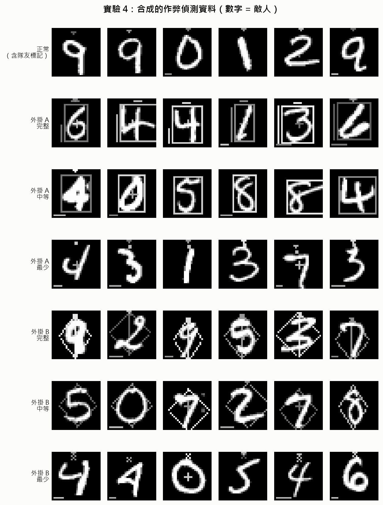
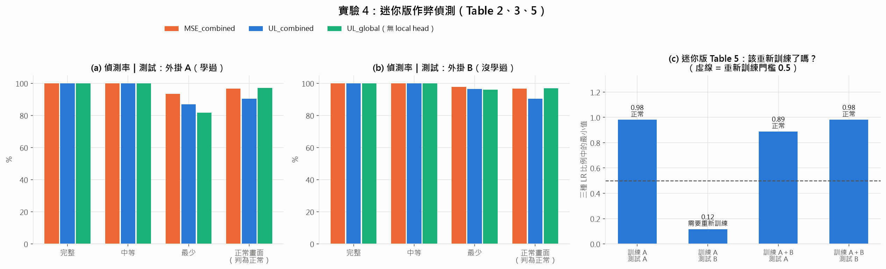
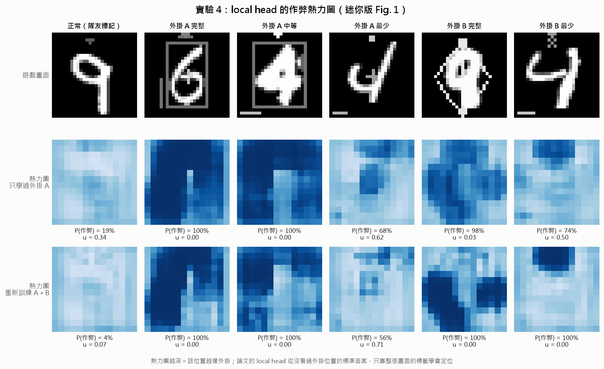
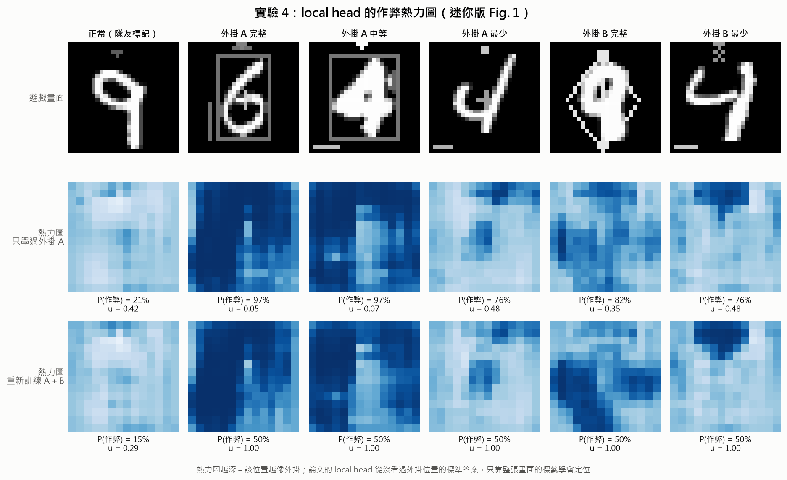
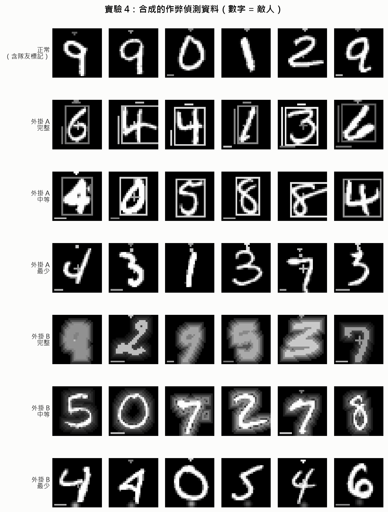
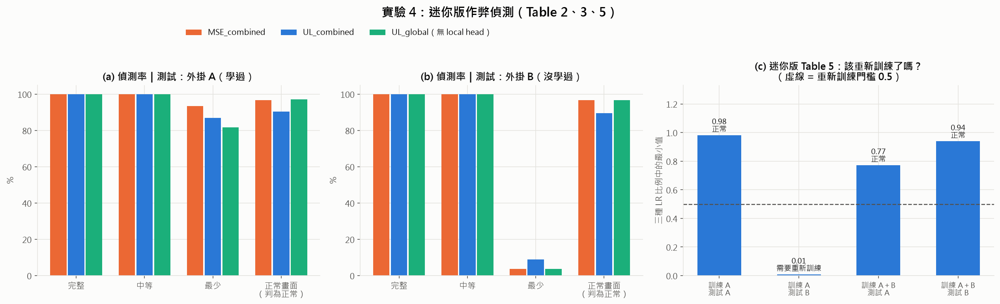
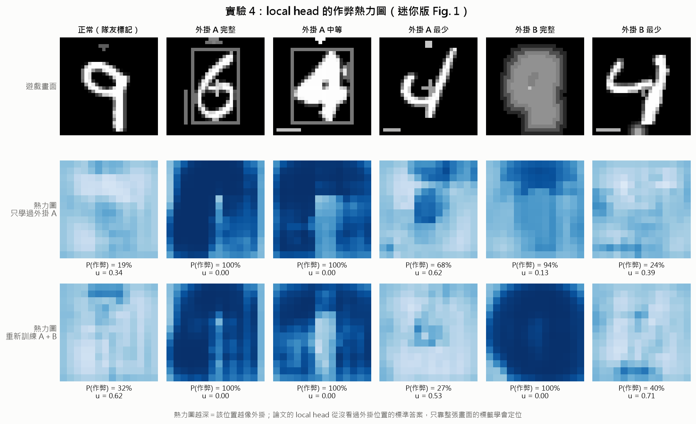

# 以證據式深度學習量化分類不確定度（Evidential Deep Learning to Quantify Classification Uncertainty）

[](https://arxiv.org/abs/1806.01768)

> **關於這個 fork**
> 本專案 fork 自 [dougbrion/pytorch-classification-uncertainty](https://github.com/dougbrion/pytorch-classification-uncertainty)，原作者為 Douglas Brion，採 MIT 授權。
> 此 fork 由 [Gavinhsu0512](https://github.com/Gavinhsu0512) 維護，內容包含：
> 1. README 全文翻譯為繁體中文
> 2. 修正原始程式碼在新版 PyTorch 上無法執行的 bug（見 [已知問題與修正](#-已知問題與修正)）
> 3. 補充原理說明與實際重現結果（見 [原理說明](#-原理說明) 與 [重現結果](#-重現結果)）
> 4. 延伸實驗：在 MNIST 上重現作弊偵測論文的主要實驗（見 [延伸實驗](#-延伸實驗)）

> ⚠️ **本專案只是課程報告用的實作 demo**，不是任何論文的官方實作，實驗結果也不代表真實遊戲中的表現。本專案在 AI 助理 Claude 協助下完成。詳見 [聲明](#-聲明)。

本專案的目的，是以 PyTorch 提供一個**容易執行、運算需求低**的 demo，示範論文 *Evidential Deep Learning to Quantify Classification Uncertainty* 所提出的方法。論文作者原本是以 TensorFlow 實作。

論文連結：<http://arxiv.org/abs/1806.01768>

收錄於：[Advances in Neural Information Processing Systems 31 (NeurIPS 2018)](https://proceedings.neurips.cc/paper/2018/hash/a981f2b708044d6fb4a71a1463242520-Abstract.html)

## 📝 目錄

- [關於](#-關於)
- [論文摘要](#-論文摘要)
- [作者](#️-作者)
- [原理說明](#-原理說明)
- [示範](#-示範)
- [重現結果](#-重現結果)
- [延伸實驗](#-延伸實驗)
- [使用方式](#-使用方式)
- [已知問題與修正](#-已知問題與修正)
- [聲明](#-聲明)
- [授權](#-授權)
- [套件需求](requirements.txt)

## 🧐 關於

本專案的目的，是以 PyTorch 提供一個容易執行、運算需求低的 demo，示範論文 *Evidential Deep Learning to Quantify Classification Uncertainty* 所提出的方法。論文作者原本是以 TensorFlow 實作。

論文連結：<http://arxiv.org/abs/1806.01768>

收錄於：[Advances in Neural Information Processing Systems 31 (NeurIPS 2018)](https://proceedings.neurips.cc/paper/2018/hash/a981f2b708044d6fb4a71a1463242520-Abstract.html)

## 📚 論文摘要

確定性神經網路（deterministic neural nets）已被證明能在各式各樣的機器學習問題上學到有效的預測器。然而，由於標準做法是訓練網路去最小化預測誤差，所得到的模型並不知道自己的預測有多可信。有別於貝氏神經網路透過權重的不確定性間接推論預測的不確定性，我們提出以主觀邏輯（subjective logic）理論直接對不確定性建模。我們在類別機率上放置一個 Dirichlet 分布，把神經網路的預測視為主觀意見（subjective opinions），並以確定性神經網路從資料中學習「收集證據、形成這些意見」的函數。對多類別分類問題而言，所得到的預測器是另一個 Dirichlet 分布，其參數由神經網路的連續輸出決定。我們初步分析了新損失函數的特性如何帶來更好的不確定度估計，並觀察到此方法在偵測分布外（out-of-distribution）查詢以及抵抗對抗擾動上，都取得了前所未有的成果。

## ✍️ 作者

論文原作者：

- Murat Sensoy
- Lance Kaplan
- Melih Kandemir

本 repo 程式碼：

- [Douglas Brion](https://github.com/dougbrion)

繁體中文翻譯、bug 修正與原理補充：

- [Gavinhsu0512](https://github.com/Gavinhsu0512)

## 💡 原理說明

### 1. 一般分類器的問題

一般的 CNN 分類器最後會接 softmax，輸出 K 個類別的機率，總和必定為 1。因此，就算輸入一張**完全沒看過**的圖片，模型也**一定得在已知類別中選一個**，而且常常給出很高的機率。

換句話說，softmax 沒辦法說「我不知道」，而**輸出機率也不是可靠的信心指標**：模型可能很有信心地答錯。

### 2. 證據式深度學習（Evidential Deep Learning, EDL）的做法

網路不直接輸出機率，而是輸出每個類別的**證據量（evidence）**，再由證據推算出機率與不確定度。對應程式碼 `losses.py`：

```python
evidence = relu_evidence(output)   # e_k = ReLU(網路輸出)，證據必須 ≥ 0
alpha = evidence + 1               # α_k = e_k + 1（Dirichlet 分布的參數）
```

由 α 可以算出三個量（K 為類別數，MNIST 中 K = 10）：

| 量 | 公式 | 意義 |
|---|---|---|
| 總證據強度 S | $S = \sum_k \alpha_k$ | 模型總共收集到多少證據 |
| 預測機率 | $p_k = \alpha_k / S$ | 預測屬於哪一類 |
| **不確定度** | $u = K / S$ | **證據越少，u 越接近 1，代表「我不知道」** |

當模型對某張圖片完全沒有證據時，所有 α 都等於 1，此時 S = K、u = 1，每個類別的機率都是 1/K，模型等於在說「都不是，我不知道」。

### 3. 損失函數

以 `--mse` 選項使用的 `edl_mse_loss`（論文 Eq. 5）為例，損失由兩部分組成。

**① 預測誤差與變異數（`loglikelihood_loss`）**

```python
loglikelihood_err = torch.sum((y - (alpha / S)) ** 2, dim=1, keepdim=True)          # 預測機率與正確答案的差距
loglikelihood_var = torch.sum(alpha * (S - alpha) / (S * S * (S + 1)), dim=1, keepdim=True)  # 預測的變異數
```

**② KL 散度懲罰項（讓模型學會說「不知道」）**

```python
kl_alpha = (alpha - 1) * (1 - y) + 1    # 移除正確類別的證據，只保留錯誤類別的證據
kl_div = annealing_coef * kl_divergence(kl_alpha, num_classes, device=device)
```

這一項的意思是：**放在錯誤類別上的證據要受罰**。模型因此學到，沒把握時寧可不給證據、讓 u 升高，而不是硬猜一個答案。

**③ 退火（annealing）**

```python
annealing_coef = min(1.0, epoch_num / annealing_step)
```

KL 懲罰的權重會隨 epoch 從 0 逐漸增加到 1。原因是訓練初期模型什麼都還不會，若一開始就重罰，模型會傾向把所有輸入都判為「不知道」。

### 4. 三種損失函數

| 指令參數 | 損失函數 | 對應論文公式 |
|---|---|---|
| `--mse` | 期望均方誤差（Expected Mean Square Error） | Eq. 5 |
| `--digamma` | 期望交叉熵（Expected Cross Entropy） | Eq. 4 |
| `--log` | 期望概似的負對數（Negative Log of the Expected Likelihood） | Eq. 3 |

三者都會加上相同的 KL 懲罰項。

### 5. 實驗設計

- **訓練**：只使用正常的 MNIST 手寫數字。
- **測試分布外資料**的兩種方式：
  - **旋轉數字 1**：從 0° 轉到 180°，讓圖片從「像訓練資料」逐漸變成「沒看過的樣子」，觀察不確定度如何隨之變化。
  - **尤達大師照片**：與手寫數字完全無關的圖片，是最極端的分布外資料。
- **對照設計**：對照組（softmax）與實驗組（EDL）使用相同的網路（LeNet）、資料與優化器，**唯一的差別是損失函數**，因此結果的差異完全來自損失函數的設計。

### 6. 專案結構

```
main.py      ← 程式入口：讀取參數，決定訓練或測試
├── data.py     ← 下載、載入 MNIST
├── lenet.py    ← 網路架構（小型 CNN：LeNet）
├── losses.py   ← ★ 三種 evidential loss（Eq. 3、4、5）與 KL 懲罰項
├── train.py    ← 訓練迴圈
├── test.py     ← 旋轉實驗、單張圖片測試
└── helpers.py  ← 旋轉圖片、one-hot 編碼等工具

延伸實驗（本 fork 新增，見「延伸實驗」一節）
├── exp_common.py            ← 共用工具：讀模型、計算 u 與 α、資料前處理、畫圖設定
├── exp1_threshold.py        ← 實驗 1：不確定就不採用（迷你版 Table 4）
├── exp2_ood.py              ← 實驗 2：自動偵測何時需要重新訓練（迷你版 Table 5）
├── exp3_fgsm.py             ← 實驗 3：FGSM 對抗攻擊（迷你版 Fig. 4）
├── exp4_data.py             ← 實驗 4：合成作弊偵測資料（MNIST + 合法介面 + 外掛圖層）
└── exp4_cheat_detection.py  ← 實驗 4：雙頭偵測網路，重現論文 Table 2～5 與 Fig. 1
```

### 7. 應用：視覺式遊戲作弊偵測

論文 [*Robust Vision-Based Cheat Detection in Competitive Gaming*](https://doi.org/10.1145/3451259)（Jonnalagadda et al., I3D 2021）在 §5.2 直接採用本方法（Sensoy Eq. 5 的 MSE 版本）估計作弊偵測器的信心。對應關係如下：

| 本 demo | 作弊偵測論文 |
|---|---|
| 旋轉後的數字 1、尤達照片 | 沒見過的新外掛、新遊戲版本（分布外資料） |
| 答錯時 u 升高 | 只在高信心時才檢舉，避免誤判正常玩家（Table 4：FP 從 96 降到 2） |
| 大量樣本 u 偏高 | 實際部署時信心整體下降，代表需要重新訓練（§5.4） |
| KL 權重隨 epoch 從 0 升到 1 | §6 前 150 個 epoch 將 KL 權重從 0 升到 1 |

對反作弊系統而言，冤枉正常玩家的代價非常高。EDL 讓模型在沒把握時說「我不知道」，系統就能只在模型有把握時才採取行動。

## 🏁 示範

> 本節圖片為原作者訓練 50 個 epoch 的結果。

### 使用 Softmax 交叉熵損失的分類網路

目前深度神經網路的標準做法，是用 softmax 將輸出層的連續值轉換成類別機率。

以下示範 softmax 型的深度神經網路在遇到樣本外（out-of-sample）查詢時如何失效。

網路訓練 50 個 epoch 後，測試準確率約為 98.9%。接著我們對 MNIST 中一個旋轉中的數字進行分類，觀察網路面對不屬於訓練資料分布的樣本時表現如何。

旋轉角度小時，圖片能以很高的機率被正確分類為「1」。然而當旋轉角度變大，即使樣本已被分錯，softmax 算出的分類機率仍然很高。

[](https://github.com/dougbrion/pytorch-classification-uncertainty/raw/master/results/rotate.jpg)

**一般網路（無不確定度）**

如上圖所示，以 softmax 機率訓練的神經網路在遇到與訓練樣本不同的輸入時，會嚴重失效。softmax 強迫神經網路選出一個類別，即使該物件屬於未知類別也一樣。當數字 1 旋轉到 60° 至 130° 之間時就出現這種情況：網路在這個範圍內把它誤判為 5 或 7，而且分類機率很高。

### 以期望均方誤差進行具不確定度的分類

理想上，我們希望網路在分類這些屬於未知類別的物件時能表現出「不確定」。要讓網路說出「我不知道」，可以將所有信念質量（belief mass）分配給整個框架（whole frame）。

如論文所述，神經網路可以訓練來學習 Dirichlet 分布的參數，而非 softmax 機率。參數 `α ≥ 1` 的 Dirichlet 分布可視為 softmax 機率（類別分布）的生成模型，它會為每個類別分布給出一個概似值。

[](https://github.com/dougbrion/pytorch-classification-uncertainty/raw/master/results/rotate_uncertainty_mse.jpg)

**期望均方誤差**

上圖顯示，此方法對誤判樣本產生的證據遠少於正確分類的樣本。無論在訓練集或測試集，誤判樣本的不確定度都很高（約 1.0），正確分類的樣本則約為 0.2。這表示神經網路對誤判的樣本非常不確定，只對正確分類的樣本給出有把握的預測。換句話說，神經網路也能透過對錯誤預測給出高不確定度，預告自己何時會失敗。

上述網路是以論文中的 Eq. 5 訓練。

### 以期望交叉熵進行具不確定度的分類

本節以論文 Eq. 4 所描述的損失函數訓練神經網路。此損失函數是對預測的 Dirichlet 分布取交叉熵損失的期望值而推導出來的。

[](https://github.com/dougbrion/pytorch-classification-uncertainty/raw/master/results/rotate_uncertainty_digamma.jpg)

**期望交叉熵**

上圖顯示，神經網路對正確分類的樣本產生了多得多的證據，因此正確分類樣本的不確定度非常低（接近 0），而誤判樣本的不確定度則非常高（約 0.7）。

### 以期望概似的負對數進行具不確定度的分類

本節以論文 Eq. 3 的損失函數重複上述實驗。

[](https://github.com/dougbrion/pytorch-classification-uncertainty/raw/master/results/rotate_uncertainty_log.jpg)

**期望概似的負對數**

### 比較樣本內與樣本外的分類

下表顯示網路對一張完全隨機的圖片（尤達大師）的反應：網路的不確定度為 1.0，且對所有類別給出相同的機率。相較之下，對樣本內的數字「1」，不確定度低得多，約 0.15，並以約 0.86 的分類機率有把握地判斷它是 1。

| MNIST 數字 1 | 隨機圖片：尤達大師 |
|---|---|
| [](https://github.com/dougbrion/pytorch-classification-uncertainty/raw/master/results/one.jpg) | [](https://github.com/dougbrion/pytorch-classification-uncertainty/raw/master/results/yoda.jpg) |

## 🔬 重現結果

以下為本 fork 在新版環境上實際重現的結果，兩組皆訓練 **10 個 epoch**（原作者為 50 個）。

**環境**：Windows、Python 3.13.2、PyTorch 2.15.0（CPU）、torchvision 0.29.2

### 訓練結果

| | 對照組（softmax） | 實驗組（EDL，`--mse`） |
|---|---|---|
| 驗證集準確率 | **98.75%** | **95.10%** |
| 訓練時間（CPU） | 5 分 32 秒 | 5 分 12 秒 |

EDL 的準確率較低，主要原因是 KL 懲罰讓模型在不確定時傾向少給證據，加上只訓練 10 個 epoch，KL 權重才剛升到完整值訓練就結束了。這是**以少許準確率換取不確定度估計**的取捨。

### 旋轉實驗

| 對照組：`results/rotate.jpg` | 實驗組：`results/rotate_uncertainty_mse.jpg` |
|---|---|
|  |  |

各角度（0°、10°、…、180°）的預測結果：

```
對照組：[1, 1, 1, 1, 1, 1, 5, 7, 7, 7, 7, 4, 4, 4, 4, 1, 1, 1, 1]
實驗組：[1, 1, 1, 1, 1, 3, 3, 3, 7, 4, 4, 4, 5, 5, 5, 8, 1, 1, 1]
```

**對照組**：轉到 70°～100° 時被判為 7，**90° 附近的機率約 0.88**；轉到 110°～140° 時被判為 4，機率約 0.4～0.5。也就是說，**模型很有信心地答錯了**。

**實驗組**：

| 旋轉角度 | 數字 1 的機率 | 不確定度 u |
|---|---|---|
| 0°～30° | 約 0.78～0.80 | 約 0.21～0.26（低） |
| 40° | 0.50 | 0.55 |
| **50°～170°** | **0.10** | **約 1.0（完全不確定）** |
| 180° | 0.29 | 0.78 |

在答錯的區間，u 全部升到約 1.0，此時 10 個類別的機率都約為 0.10，代表模型沒有給任何類別證據。因此這個區間的預測結果（3、7、4、5、8）其實沒有意義，模型真正表達的是「我不知道」。

### 單張圖片測試

| 輸入 | 對照組 | 實驗組 |
|---|---|---|
| 數字 1（`one.jpg`） | 預測 1，機率 0.9992 | 預測 1，機率 0.7746，**u = 0.2504** |
| 尤達照片（`yoda.jpg`） | 預測 0，機率 0.2000 | 預測 0，機率 0.4050，**u = 0.6612** |

可以用 $u = K/S$ 反推證據量，驗證 KL 懲罰項的效果：

- **數字 1**：$S = 10 / 0.2504 \approx 40$，類別 1 的 $\alpha \approx 0.7746 \times 40 \approx 31$，即**證據約 30**；其餘 9 類 $\alpha = 0.025 \times 40 = 1$，即**證據為 0**。
- **尤達**：$S = 10 / 0.6612 \approx 15$，類別 0 的**證據約 5**；其餘 9 類**證據為 0**。

錯誤類別的證據被壓到 0，模型只對有把握的類別給證據。數字 1 拿到約 30 份證據，尤達只有約 5 份，因此尤達的不確定度明顯較高。

### 對照組與實驗組比較

| 測試情境 | 對照組（softmax） | 實驗組（EDL） |
|---|---|---|
| 正常數字 1 | 機率 99.9%，正確 | u = 0.25，正確且有把握 |
| 轉 90° 的數字 1 | 判為 7，機率約 88%，**很有信心地答錯** | u ≈ 1.0，**知道自己不知道** |
| 尤達照片 | 機率 20%，沒有不確定度可參考 | u = 0.66，明顯偏高 |
| 能否判斷「該不該相信這次預測」 | ❌ 機率時高時低，沒有規律 | ✅ u 高就不採用 |

若設定門檻「u > 0.5 時不採用預測」：正常的數字 1 會被採用，轉 50°～170° 的所有錯誤預測與尤達照片都會被擋下。

### 限制

1. **轉到 160°～180° 時過於保守**：數字 1 轉 180° 後仍是一條直線，對照組在 160° 就認回來了，實驗組到 170° 的 u 仍接近 1。推測是訓練 epoch 不足所致。
2. **尤達的 u 只有 0.66**：原作者訓練 50 個 epoch 的結果為 1.0。
3. **準確率下降約 3.6 個百分點**。

## 🧪 延伸實驗

論文 [*Robust Vision-Based Cheat Detection in Competitive Gaming*](https://doi.org/10.1145/3451259)（I3D 2021）有三個核心技術。實驗 1～3 在 MNIST 上做出迷你版，逐一驗證論文的主張；實驗 4 則把整篇論文縮小到 MNIST 上重做一次。

| 實驗 | 對應論文 | 想回答的問題 | 程式 |
|---|---|---|---|
| 1 | §5.3、Table 4 | 「不確定就不採用」能減少誤判嗎？ | `exp1_threshold.py` |
| 2 | §5.4、Table 5 | 遇到新情境，模型能自己察覺該重新訓練嗎？ | `exp2_ood.py` |
| 3 | §6、Fig. 4、Table 6 | 對抗攻擊下，偵測器還可靠嗎？ | `exp3_fgsm.py` |
| 4 | §3～§5、Table 2～5、Fig. 1 | 把 MNIST 改造成作弊偵測，論文的結論還成立嗎？ | `exp4_cheat_detection.py` |

實驗 1～3 直接載入 [重現結果](#-重現結果) 一節訓練好的兩個模型（各訓練 10 個 epoch），**不需要重新訓練**；實驗 4 會訓練自己的 4 個作弊偵測器。

### 執行方式

```powershell
python exp1_threshold.py
python exp2_ood.py               # 第一次執行會自動下載 Fashion-MNIST（約 30 MB）
python exp3_fgsm.py
python exp4_cheat_detection.py   # 會訓練 4 個偵測器，CPU 上約 5～15 分鐘
```

實驗 1～3 在 CPU 上各約 1～3 分鐘，結果圖會存到 `results/`。`exp_common.py` 是共用工具，會自動偵測 `data.py` 的前處理方式，確保旋轉、雜訊、攻擊後的圖片都跟訓練時使用同一套前處理。

Fashion-MNIST 會下載到 `data/FashionMNIST/`，已加入 `.gitignore`。

### 共用設定（實驗 1～3）

- **有信心的定義**：不確定度 ≤ 0.5。EDL 使用 u；softmax 使用「1 - 最大機率」。
- **預測類別**：EDL 以 logits 的最大值決定，與原作者 `train.py`、`test.py` 一致（原因見 [實作細節](#實作細節u--1-時的預測類別)）。
- **測試資料**：MNIST 測試集 10,000 張。

### 實驗 1：不確定就不採用（迷你版 Table 4）

**做法**：在兩組資料上，把每個預測依「有信心／沒信心」×「答對／答錯」分成四格，仿照論文 Table 4。

- 乾淨 MNIST：跟訓練資料同分布
- 旋轉 MNIST：每張圖隨機旋轉 0°～180°，模擬沒見過的新情境


| 資料 | 模型 | 準確率 | 信心高-對 | **信心高-錯** | 信心低-對 | 信心低-錯 | 採用比例 | 採用準確率 | 擋下準確率 | AUROC |
|---|---|---|---|---|---|---|---|---|---|---|
| 乾淨 MNIST | softmax | 98.8% | 9847 | **100** | 28 | 25 | 99.5% | 99.0% | 52.8% | 0.980 |
| 乾淨 MNIST | EDL | 95.1% | 7655 | **18** | 1855 | 472 | 76.7% | 99.8% | 79.7% | 0.923 |
| 旋轉 MNIST | softmax | 39.2% | 3560 | **4396** | 364 | 1680 | 79.6% | 44.7% | 17.8% | 0.766 |
| 旋轉 MNIST | EDL | 35.4% | 1384 | **503** | 2155 | 5958 | 18.9% | 73.3% | 26.6% | 0.708 |

- **信心高-錯**：模型很有信心卻答錯，對應論文的 FP（冤枉正常玩家），是最危險的錯誤。
- **AUROC**：不確定度能不能分辨對錯。隨機抽一個答錯和一個答對的樣本，答錯那個不確定度比較高的機率；0.5 等於亂猜，1.0 為完美。

**解讀**

1. **同一個門檻下，危險的錯誤大幅減少**：信心高-錯在乾淨資料從 100 降到 18（約 5.6 倍），旋轉資料從 4396 降到 503（約 8.7 倍）。這與論文 Table 4 的 FP 從 96 降到 2 是同一個現象。
2. **但 EDL 的排序能力沒有比較好**：兩組資料的 AUROC 都是 softmax 較高。從圖 (a) 看，若 softmax 也只採用最有信心的 19%，準確率約 83%，反而高於 EDL 的 73.3%。原因在圖 (c)：旋轉資料中約 4,500 張圖的 u 都落在 1.0，EDL 知道自己不知道，卻無法再分辨「不知道的程度」。
3. **EDL 真正的優勢是門檻有絕對意義**：0.5 這個門檻不需要調整，遇到新情境就自動生效。softmax 要達到同樣效果，必須把門檻調到非常嚴格，而那個門檻要先看過新資料才調得出來；實務上不可能事先拿到明天才出現的新外掛來調門檻。
4. **代價是過於保守**：乾淨資料上 EDL 拒答了 23.3%，被擋下的圖有 79.7% 其實答對，推測與只訓練 10 個 epoch 有關。

### 實驗 2：自動偵測何時需要重新訓練（迷你版 Table 5）

**做法**：仿照論文 §5.4 的 likelihood ratio（Eq. 8）。

- 論文是二分類，LR = max(α) / min(α)。MNIST 有 10 類，推廣為「**第一名的 α ÷ 第二名的 α**」，二分類時兩者完全相同。
- 以訓練資料（隨機抽 10,000 張）的平均 LR 為基準，計算各組資料的平均 LR 比例。
- 依論文規則：**比例低於 0.5，就發出「需要重新訓練」警報**。
- 把模型沒看過的資料當成「新外掛」：旋轉 90° 的 MNIST（同一款遊戲，畫面變了）、Fashion-MNIST（換了一款遊戲）、隨機雜訊（完全沒意義的畫面）。


| 資料 | LR 比例 | 判斷 |
|---|---|---|
| MNIST 測試集 | 1.02 | 正常 |
| 旋轉 90° MNIST | 0.14 | 需要重新訓練 |
| Fashion-MNIST | 0.11 | 需要重新訓練 |
| 隨機雜訊 | 0.04 | 需要重新訓練 |

訓練基準每次都是隨機抽樣，所以比例會有小幅波動（例如 MNIST 測試集在不同次執行為 1.02～1.03）。

**解讀**

1. **四組全部判斷正確，而且完全不需要標準答案**。與論文 Table 5 的結論一致：同分布的資料比例接近 1，換了分布就掉到 0.5 以下。
2. **softmax 對沒看過的東西照樣很有自信**：圖 (a) 中，EDL 在三組新資料上的 u 中位數都是 1.0；softmax 的「1 - 最大機率」中位數只有約 0.2～0.35，而且它對**純雜訊**的信心，甚至比對旋轉 90° 的數字還高。

#### 把衣服丟給只學過數字的模型


softmax 把套頭衫認成「8」（信心 99%），T 恤認成「8」（信心 94%）。各類別的統計（節錄）：

| 衣服類別 | softmax 最常認成 | 占比 | softmax 平均信心 | EDL 平均 u |
|---|---|---|---|---|
| 外套 | 8 | 81.9% | 65.0% | 0.994 |
| 襯衫 | 8 | 85.4% | 64.2% | 0.994 |
| 包包 | 8 | 59.6% | 65.2% | 0.865 |
| 涼鞋 | 2 | 53.3% | 56.4% | 0.804 |
| 運動鞋 | 2 | 77.0% | 70.5% | 0.792 |
| 短靴 | 2 | 57.9% | 73.5% | 0.818 |

- **模型其實有規律地在找最像的數字**：鞋子類大多被認成 **2**（底部一條橫線，像 2 的筆畫），衣服和包包類大多被認成 **8**（一團封閉的形狀）。
- **EDL 對鞋子的平均 u（約 0.79～0.82）比衣服（約 0.99）低**，代表鞋子在它眼中真的比較像數字。
- **失敗案例**：短靴被 EDL 有信心地認成「2」（u = 0.39）。分布外資料剛好長得像訓練資料時，EDL 也會被騙，這是這類方法已知的弱點。

### 實驗 3：FGSM 對抗攻擊（迷你版 Fig. 4）

**做法**：FGSM（Fast Gradient Sign Method）只算一次梯度，把每個像素往「讓模型更錯」的方向推一小步：

$$x_{adv} = \text{clip}\left(x + \epsilon \cdot \text{sign}(\nabla_x \text{Loss}),\ 0,\ 1\right)$$

攻擊強度 ε 從 0 到 0.3（像素值範圍 0～1），比較三種情境：

| 情境 | 說明 |
|---|---|
| softmax（白箱攻擊） | 攻擊者知道 softmax 模型的權重，直接攻擊它 |
| EDL（白箱攻擊） | 攻擊者知道 EDL 模型的權重，直接攻擊它（論文假設的最壞情況） |
| EDL（遷移攻擊） | 用 softmax 模型算出的攻擊去打 EDL；論文提到攻擊者實務上常常只有替代模型 |


**白箱攻擊的比較**（ε = 0 為精確值；標「約」者為從圖上讀取的近似值）

| ε | softmax 準確率 | EDL 準確率 | softmax 被騙且有信心 | EDL 被騙且有信心 | softmax 平均不確定度 | EDL 平均 u |
|---|---|---|---|---|---|---|
| 0 | 98.8% | 95.1% | 1.0% | 0.2% | 約 0.02 | 約 0.42 |
| 0.10 | 約 85% | 約 82% | 約 12% | 約 1.5% | 約 0.14 | 約 0.72 |
| 0.20 | 約 32% | 約 31% | 約 52% | 約 3% | 約 0.32 | 約 0.92 |
| 0.30 | 約 2% | 約 13% | 約 72% | 約 5.5% | 約 0.32 | 約 0.93 |

**EDL（遷移攻擊）**

| ε | 準確率 | 有信心比例 | 被騙且有信心 | 平均 u |
|---|---|---|---|---|
| 0.10 | 82.0% | 41.0% | 1.0% | 0.631 |
| 0.15 | 65.0% | 21.5% | 2.4% | 0.780 |
| 0.20 | 40.0% | 11.3% | 4.0% | 0.866 |
| 0.25 | 21.5% | 7.9% | 5.3% | 0.902 |
| 0.30 | 10.8% | 6.6% | 6.0% | 0.913 |

**解讀**

1. **EDL 並沒有比較不會被騙**：兩個模型被攻擊時，準確率掉得差不多快。
2. **差別在被騙之後**：softmax 被騙時還很有信心（ε = 0.3 時約 72%）；EDL 被騙時 u 升到約 0.93，大多會被信心篩選擋下（約 5.5%）。範例圖中，ε = 0.15 時畫面已佈滿雜訊，softmax 仍說「7，信心 93%」，EDL 的 u 已升到 0.61，ε = 0.2 起完全不確定。這呼應論文 Table 6：只換成 uncertainty loss（UL_combined），面對 FGSM 的防禦比例就從 0.62 提升到 0.81。
3. **漏網之魚**：遷移攻擊在 ε = 0.30 時，有信心的預測只剩 6.6%，其中 6.0% 是被騙的，也就是**還敢說有信心的預測，約 91% 都是錯的**。不確定度篩選只能提供實務上的抵抗力，沒有數學保證；這正是論文還要加入 IBP 的原因：IBP 能算出「在 ε 範圍內保證攻擊不了」的下界（Table 6 的 IBP bound）。
4. **遷移攻擊比白箱攻擊弱**：在中等強度下，遷移攻擊後的準確率較高（ε = 0.15：65.0% vs 約 56%；ε = 0.20：40.0% vs 約 31%），符合「攻擊者只有替代模型時效果較差」。

### 實驗 4：把整篇論文縮小到 MNIST 上重做一次

實驗 1～3 各自驗證論文的一項技術；實驗 4 則仿照論文的完整流程：合成作弊資料集、訓練雙頭偵測網路，再重現 Table 2～5 與 Fig. 1。

#### 資料（對應論文 §3）

每張「遊戲畫面」由三層組成：

1. **MNIST 數字**：畫面中的敵人
2. **合法介面（HUD）**：正常畫面和作弊畫面都可能出現
   - 準心（畫面中央的小十字）、自己的血條（左下角的橫條）
   - **隊友標記**（數字上方的小倒三角形）：真實遊戲中隊友頭上的合法標記，外觀跟外掛很像，是誤判的主要來源
3. **透視外掛圖層**（只有作弊畫面才有），仿照論文分成三種作弊資訊量：

| 外掛 | 完整 | 中等 | 最少 |
|---|---|---|---|
| A：方框 ESP（訓練用） | 方框 + 血條 + 名字標籤 | 只有方框 | 數字正上方 2×2 小點 |
| B（菱形版）：菱形 + 骨架 ESP（模擬沒見過的新外掛） | 菱形框 + 骨架中線 + 小 x | 只有菱形框 | 數字正上方 3×3 小 x |

外掛 B 另有一個視覺風格完全不同的發光版，見 [讓外掛 B 真的「新」](#讓外掛-b-真的新發光透視版)。

外掛亮度在 0.35～1.0 之間隨機，越暗越難偵測；「最少」等級平均只有 4～5 個像素。訓練集各 20,000 張、測試集各 6,000 張，作弊與正常各半，測試集中各等級數量相同。訓練用的數字來自 MNIST 訓練集，測試用的來自 MNIST 測試集。



#### 網路與模型（對應論文 §4）

| | 論文 | 本實驗 |
|---|---|---|
| 輸入 | 1080 × 1920 × 3 | 28 × 28 × 1 |
| 卷積層 | 4 層，48 / 48 / 32 / 16 個濾波器 | 4 層，24 / 24 / 16 / 16 個濾波器 |
| global head | 平均池化 → 全連接 16 × 2 | 平均池化 → dropout（p = 0.15）→ 全連接 16 × 2 |
| local head | 1 × 1 卷積 → logsig | 1 × 1 卷積 → sigmoid，輸出 14 × 14 熱力圖 |

local head 沒有像素級的標準答案，依論文做法，以整張畫面的標籤（作弊 0.9、正常 0.1）當作每個位置的目標。

| 代號 | 損失函數 | 訓練資料 | 用途 |
|---|---|---|---|
| `mse_A` | MSE_combined | 外掛 A | Table 4 的對照組 |
| `ul_A` | UL_combined | 外掛 A | 論文的主要方法 |
| `ulg_A` | UL_global（拿掉 local head） | 外掛 A | Table 2 的消融實驗 |
| `ul_AB` | UL_combined | 外掛 A＋B | Table 5 的「重新訓練」 |

每個模型訓練 8 個 epoch。UL 模型的證據函數採用論文 Eq. 5 的 exp（原因見下方 [ReLU 與 exp 的比較](#relu-與-exp為什麼論文用-exp-當證據函數)）。

```powershell
python exp4_cheat_detection.py --new-cheat diamond                   # 外掛 B 用菱形版（本節「結果」的設定）
python exp4_cheat_detection.py --new-cheat diamond --evidence relu   # 同上，但 UL 模型用 ReLU 證據，重現「證據死掉」的問題
python exp4_cheat_detection.py                                       # 外掛 B 用發光版（預設，見「讓外掛 B 真的新」）
python exp4_cheat_detection.py --reuse                               # 任何組合加上 --reuse，都會沿用已訓練的模型
```

輸出檔名的後綴：發光版加 `_glow`、ReLU 證據加 `_relu`，菱形版加 exp 證據則沒有後綴。完整數字：[`results/exp4_summary.md`](results/exp4_summary.md)（菱形版）、[`results/exp4_summary_relu.md`](results/exp4_summary_relu.md)（菱形版 + ReLU）、[`results/exp4_summary_glow.md`](results/exp4_summary_glow.md)（發光版）。

#### 結果

以下為菱形版外掛 B 的結果。



**迷你版 Table 2、3：各作弊等級的偵測率**（三個模型都只學過外掛 A）

| 模型 | 測試資料 | 完整 | 中等 | 最少 | 正常畫面（判為正常） | 整體準確率 |
|---|---|---|---|---|---|---|
| MSE_combined | 外掛 A | 100.0% | 100.0% | 93.5% | 96.6% | 97.2% |
| MSE_combined | 外掛 B | 100.0% | 100.0% | 97.8% | 96.7% | 98.0% |
| UL_combined | 外掛 A | 100.0% | 100.0% | 86.9% | 90.3% | 93.0% |
| UL_combined | 外掛 B | 100.0% | 100.0% | 96.5% | 90.3% | 94.6% |
| UL_global（無 local head） | 外掛 A | 100.0% | 100.0% | 81.8% | 97.1% | 95.5% |
| UL_global（無 local head） | 外掛 B | 100.0% | 100.0% | 96.0% | 96.9% | 97.8% |

- **「最少」等級最難偵測**，與論文 Table 3 一致。
- **local head 有幫助，但幅度不大**：「最少」等級從 81.8% 提升到 86.9%（約 5 個百分點），與論文相近（論文 Table 3 平均池化的「最少」等級，加了 local head 從 0.64 升到 0.67）。
- **代價是誤報**：加了 local head 的 UL_combined，正常畫面判為正常的比例從 97.1% 降到 90.3%，整體準確率反而較低（93.0% vs 95.5%）。

**誤報來源：合法的隊友標記**

| 模型 | 有隊友標記的正常畫面誤報率 | 沒有隊友標記的正常畫面誤報率 |
|---|---|---|
| MSE_combined | 4.6% | 2.8% |
| UL_combined | **16.9%** | 6.5% |
| UL_global（無 local head） | 4.1% | 2.4% |

UL_combined 與 UL_global 只差在有沒有 local head。local head 讓模型對小線索更敏感，也更容易把合法的隊友標記當成外掛，誤報率約為 4 倍。對反作弊系統來說，多抓 5% 的作弊者卻換來 4 倍的冤枉正常玩家，未必划算。論文沒有測試這類合法介面的干擾，這是本實驗額外的發現。

**迷你版 Table 4：信心篩選能減少誤判嗎？**（測試：外掛 A，6,000 張，作弊 3,000 張）

| 損失函數 | 信心篩選 | 有信心 TP | 有信心 FN | 有信心 FP | 有信心 TN | 沒信心 TP | 沒信心 FN | 沒信心 FP | 沒信心 TN |
|---|---|---|---|---|---|---|---|---|---|
| MSE_combined | 無 | 2935 | 65 | 102 | 2898 | — | — | — | — |
| MSE_combined | VR = 0 | 2786 | 38 | 43 | 2868 | 149 | 27 | 59 | 30 |
| UL_combined | 無 | 2869 | 131 | 291 | 2709 | — | — | — | — |
| UL_combined | VR = 0 | 2417 | 30 | 72 | 2456 | 452 | 101 | 219 | 253 |
| UL_combined | VR = 0 且 u ≤ 0.5 | 2200 | **2** | **24** | 2075 | 669 | 129 | 267 | 634 |

與論文 Table 4 對照（FP = 正常畫面被判為作弊）：

| | 本實驗 | 論文 |
|---|---|---|
| MSE_combined 的 FP | 102 | 96 |
| MSE_combined + VR 的 FP | 43 | 51 |
| UL_combined 的 FP | 291 | 2 |
| UL_combined + VR 的 FP | 72 | 0 |

- **VR 篩選的效果與論文非常接近**。
- **只換成 uncertainty loss 並沒有減少誤判**：FP 291，比 MSE 的 102 還多，與論文相反，主因是上述隊友標記造成的誤報。
- **不確定度要拿來篩選才有效**：VR 與 u 同時篩選後，有信心的預測中 FP 只有 24、FN 只有 2，是所有設定中最低；代價是 28.3% 的畫面被歸為「沒信心」不處理。

**迷你版 Table 5：新外掛出現時，能自動發現該重新訓練嗎？**

| 訓練資料 | 測試資料 | LR_tot 比例 | LR_pos 比例 | LR_neg 比例 | 敏感度 | 精確度 | 準確率 | 需要重新訓練？ |
|---|---|---|---|---|---|---|---|---|
| 外掛 A | 外掛 A | 0.98 | 0.98 | 1.01 | 95.6% | 90.8% | 93.0% | 否 |
| 外掛 A | 外掛 B | **0.12** | **0.12** | 1.03 | 98.8% | 91.1% | 94.6% | **是** |
| 外掛 A＋B | 外掛 A | 0.89 | 0.96 | 0.95 | 85.3% | 99.2% | 92.3% | 否 |
| 外掛 A＋B | 外掛 B | 1.06 | 0.98 | 1.07 | 99.2% | 99.3% | 99.2% | 否 |

| | 本實驗（A → B） | 論文（S_A → S_B） |
|---|---|---|
| 最小 LR 比例 | 0.12 | 0.14 |
| 敏感度 | 98.8% | 0.17 |
| 需要重新訓練？ | 是 | 是 |

- **警報正確觸發**，LR 比例與論文幾乎相同。
- **但敏感度沒有下降**：我們合成的兩種外掛都是細亮線，視覺特徵太接近；真實外掛之間的差異（顏色、字型、發光效果）大得多。所以這裡的警報反映的是「分布改變、信心下降」，而不是「表現變差」。
- **重新訓練後**，所有比例回到約 1，精確度從約 91% 提升到約 99%；代價是外掛 A 的敏感度從 95.6% 降到 85.3%。

**迷你版 Fig. 1：local head 的作弊熱力圖**



| 熱力圖最亮的位置落在外掛上的比例（測試：外掛 A） | 完整 | 中等 | 最少 |
|---|---|---|---|
| MSE_combined | 62.9% | 20.5% | 17.9% |
| UL_combined | 80.8% | 35.4% | 15.3% |
| 隨機猜一個位置 | 33.8% | 27.7% | 2.0% |

- **「最少」等級能定位**：命中率約為隨機猜的 7.7 倍（15.3% vs 2.0%）。重新訓練後，外掛 B「最少」的熱力圖深色區塊正好落在頂端的小 x 上。模型從沒看過外掛位置的標準答案，只靠整張畫面的標籤就學會定位，與論文的主張一致。
- **「完整」、「中等」的熱力圖整片偏深**：4 層卷積後，熱力圖每一格的感受野是 13 × 13 像素（約半張圖），而方框幾乎佔滿畫面，每一格都看得到方框，因此「中等」的命中率接近隨機（35.4% vs 27.7%）。

#### ReLU 與 exp：為什麼論文用 exp 當證據函數？

本專案的 `losses.py` 用 ReLU 把網路輸出轉成證據（e = ReLU(l)），論文 Eq. 5 則用 exp（e = exp(l)）。實驗 4 第一次執行時沿用了 ReLU，結果重新訓練的模型 `ul_AB` 出了問題：



| | ReLU | exp |
|---|---|---|
| `ul_AB` 在作弊畫面的 u | 全部 1.00（證據為 0） | 正常（例如外掛 A 完整 u = 0.00） |
| `ul_AB` 對外掛 A 的敏感度 | 72.8% | 85.3% |
| `ul_AB` 的 Table 5 警報 | 否 | 否 |
| UL_global 的「最少」等級偵測率（外掛 A） | **3.1%** | 81.8% |

1. **證據死掉**：ReLU 在輸入為負時，輸出和梯度都是 0。`ul_AB` 訓練過程中，「作弊」類別的輸出對所有畫面都變成負數，證據永遠是 0，再也學不回來。exp 永遠大於 0、梯度永遠存在，不會發生這個問題。**論文選 exp 而不是 ReLU，是有實際理由的。**
2. **零梯度讓 local head 的效果被誇大**：ReLU 版本中，沒有 local head 的模型在「最少」等級只抓到 3.1%。訊號很弱的樣本，網路輸出容易落在負數區，這些樣本完全無法提供學習訊號；local head 的損失則提供了另一條不經過 ReLU 的梯度路徑。換成 exp 之後，差距縮小到約 5 個百分點。
3. **LR 監控的盲點**：ReLU 版本的 `ul_AB` 已經壞了，Table 5 卻判斷「不需要重新訓練」。LR 比例只能偵測部署後相對於訓練時的**變化**，無法發現訓練本身就失敗的模型。

#### 讓外掛 B 真的「新」：發光透視版

菱形版外掛 B 跟外掛 A 一樣是細亮線，只學過外掛 A 的模型輕易就認得出來（敏感度 98.8%），無法重現論文中「新外掛讓偵測器失效」的情況（論文 S_A → S_B 的敏感度只剩 0.17）。因此另外設計一個視覺風格完全不同的外掛 B：

| 等級 | 菱形版 | 發光版 |
|---|---|---|
| 完整 | 菱形框 + 骨架中線 + 小 x | 敵人全身改成單色（chams）+ 外圍柔和發光 |
| 中等 | 只有菱形框 | 只有外圍柔和發光 |
| 最少 | 頭頂 3×3 小 x | 敵人腳下一團柔和小光暈（類似「腳步聲 ESP」） |

發光版沒有任何細直線或小方塊；「最少」等級刻意放在腳下，避免跟外掛 A 頭頂小點的位置重疊。只學過外掛 A 的三個模型跟外掛 B 的版本無關，直接沿用；只有 `ul_AB` 以發光版重新訓練。所有「測試：外掛 A」的數字都與菱形版完全相同，可以確認這次更動沒有影響外掛 A 的部分。





**各等級偵測率**（三個模型都只學過外掛 A，測試：發光版外掛 B）

| 模型 | 完整 | 中等 | 最少 | 正常畫面（判為正常） | 整體準確率 |
|---|---|---|---|---|---|
| MSE_combined | 99.9% | 100.0% | **3.8%** | 96.7% | 82.3% |
| UL_combined | 100.0% | 100.0% | **8.9%** | 89.5% | 79.6% |
| UL_global（無 local head） | 100.0% | 100.0% | **3.8%** | 96.7% | 82.3% |

**迷你版 Table 5（發光版）**

| 訓練資料 | 測試資料 | LR_tot 比例 | LR_pos 比例 | LR_neg 比例 | 敏感度 | 精確度 | 準確率 | 需要重新訓練？ |
|---|---|---|---|---|---|---|---|---|
| 外掛 A | 外掛 A | 0.98 | 0.98 | 1.01 | 95.6% | 90.8% | 93.0% | 否 |
| 外掛 A | 發光版外掛 B | **0.01** | **0.01** | 1.04 | **69.6%** | 86.9% | 79.6% | **是** |
| 外掛 A＋B | 外掛 A | 0.77 | 0.82 | 1.02 | 67.2% | 98.9% | 83.2% | 否 |
| 外掛 A＋B | 發光版外掛 B | 1.17 | 1.17 | 0.94 | 71.5% | 98.6% | 85.2% | 否 |

| | 菱形版（A → B） | 發光版（A → B） | 論文（S_A → S_B） |
|---|---|---|---|
| 最小 LR 比例 | 0.12 | 0.01 | 0.14 |
| 敏感度 | 98.8% | 69.6% | 0.17 |
| 需要重新訓練？ | 是 | 是 | 是 |



**解讀**

1. **細微的新外掛幾乎完全偵測不到**：發光版「最少」等級只抓到 3.8%～8.9%。論文「新外掛讓偵測器失效」的現象，在細微等級重現了。
2. **大面積的改變仍然抓得到**：「完整」「中等」幾乎都是 100%。整片發光或單色的敵人，對只學過方框的模型來說也是明顯的異常，因此整體敏感度是 69.6%，沒有掉到論文的 0.17。
3. **有信心地漏抓**：熱力圖中，只學過外掛 A 的模型面對發光版「最少」，判斷 P(作弊) = 24%、u = 0.39，也就是「有信心地判為正常」。看起來跟正常畫面幾乎一樣的新外掛，連不確定度都察覺不到，信心篩選擋不住這種漏抓。
4. **LR 警報非常強烈**：比例掉到 0.01，遠低於 0.5 的門檻。
5. **重新訓練沒有修好**：用外掛 A＋B 重新訓練（同樣 8 個 epoch）後，發光版外掛 B 的敏感度只從 69.6% 升到 71.5%，外掛 A 反而從 95.6% 掉到 67.2%；精確度則升到約 99%。模型變得保守，寧可漏抓細微的外掛也不誤判。若「完整」「中等」維持 100%（熱力圖範例中是如此），可推算兩種「最少」等級大多仍抓不到（外掛 A 約 2%、外掛 B 約 15%）。
6. **LR 監控的盲點再次出現**：重新訓練後的 LR 比例都接近 1，判斷「不需要重新訓練」，但模型其實漏掉大部分細微的外掛。因為它在訓練資料上本來就抓不到，「跟訓練時比」看不出任何變化。
7. **平均池化稀釋了證據**：重新訓練後的熱力圖中，外掛 B「最少」的腳下位置出現深色區塊，代表 local head 確實找到了光暈；但 global head 的 P(作弊) 只有 40%。這正是論文 §4 提到的平均池化缺點：小範圍的證據被整張畫面平均掉了。

#### 實驗 4 總結

| 論文的主張 | 結果 |
|---|---|
| 「最少」等級最難偵測（Table 3） | ✅ 成立 |
| local head 有幫助（Table 2） | ✅ 成立，約 5 個百分點，與論文相近；但會增加合法介面造成的誤報 |
| VR 篩選能減少誤判（Table 4） | ✅ 成立，數字與論文非常接近（102 → 43 vs 96 → 51） |
| uncertainty loss 本身就能減少誤判（Table 4） | ❌ 本實驗不成立，必須搭配信心篩選才有效 |
| LR 能偵測新外掛（Table 5） | ✅ 成立，但偵測的是分布改變，不一定代表表現變差 |
| 新外掛會讓偵測器失效（Table 5） | ⚠️ 部分成立：發光版「最少」等級幾乎抓不到（3.8%～8.9%），但大面積的外掛仍抓得到，整體敏感度 69.6%（論文 0.17） |
| 重新訓練後表現會恢復（§5.4） | ❌ 本實驗不成立：精確度升到約 99%，但細微的外掛大多仍漏抓，LR 卻判斷「正常」 |
| 平均池化可能稀釋作弊證據（§4） | ✅ 熱力圖找到了腳下的光暈，global head 卻只給 40% |
| 以 exp 作為證據函數（Eq. 5） | ✅ ReLU 會讓證據死掉，exp 不會 |

### 綜合結論

| 論文的主張 | 驗證實驗 | 結果 |
|---|---|---|
| 信心分析能大幅減少誤判（§5.3） | 實驗 1 | ✅ 成立，但優勢來自「門檻有絕對意義」，而不是排序能力較好 |
| LR 能自動偵測何時需要重新訓練（§5.4） | 實驗 2 | ✅ 完全成立，4 組資料全部判斷正確 |
| Uncertainty loss 提升對抗攻擊的實務抵抗力（§6） | 實驗 3 | ✅ 成立，被騙且有信心從約 72% 降到約 5.5% |
| 但沒有數學保證，需要 IBP（§6） | 實驗 3 遷移攻擊 | ✅ 強攻擊下漏網的有信心預測約 91% 是錯的 |
| 「最少」等級最難偵測；local head 有幫助（Table 2、3） | 實驗 4 | ✅ 成立，local head 約提升 5 個百分點，但會增加合法介面造成的誤報 |
| VR 篩選能減少誤判（Table 4） | 實驗 4 | ✅ 成立，FP 102 → 43，與論文的 96 → 51 非常接近 |
| uncertainty loss 本身就能減少誤判（Table 4） | 實驗 4 | ❌ 不成立，必須搭配信心篩選才有效 |
| LR 能偵測新外掛（Table 5） | 實驗 2、實驗 4 | ✅ 成立，但偵測的是分布改變，無法發現訓練時就失敗的模型 |
| 新外掛會讓偵測器失效（Table 5） | 實驗 4（發光版） | ⚠️ 部分成立：細微的新外掛幾乎抓不到，大面積的仍抓得到 |
| 重新訓練就能恢復（§5.4） | 實驗 4（發光版） | ❌ 不一定：重新訓練後細微的外掛大多仍漏抓，LR 卻判斷「正常」 |
| 以 exp 作為證據函數（Eq. 5） | 實驗 4 | ✅ ReLU 會讓證據死掉，論文的選擇有實際理由 |

總結：**EDL 的價值不是讓模型更準，而是讓「不確定」成為一個可以直接使用的訊號**，系統因此能在沒把握時選擇不行動。此外，本 fork 的實驗也發現論文沒有討論的三個限制：**合法介面（例如隊友標記）會造成誤報**；**看起來跟正常畫面幾乎一樣的新外掛，連不確定度都察覺不到**；以及 **LR 監控看不到訓練時就失敗、或從未學會的情況**。

### 限制

- 使用 MNIST 與 LeNet，與論文的 1080p 遊戲畫面、二分類作弊偵測任務差距很大。
- 兩個模型只訓練 10 個 epoch（原作者為 50 個），EDL 偏保守。
- 每個實驗只執行一次，沒有用多個亂數種子取平均；部分數值為從圖上讀取的近似值。
- 對抗攻擊只測試 FGSM（論文另有 universal attack 與 PGD/Madry），也沒有實作 IBP。
- 實驗 4 的外掛與合法介面都是程式合成的：菱形版外掛 B 跟外掛 A 太接近；發光版雖然重現了細微外掛的漏抓，但大面積的外掛仍容易被抓到。28 × 28 的輸入也讓熱力圖的解析度有限；重新訓練只用了 8 個 epoch，沒有調整其他超參數。

### 實作細節：u = 1 時的預測類別

當模型對一張圖完全沒有證據時，所有 α 都等於 1，十個類別平手。若用 α 取最大值決定類別，PyTorch 會固定回傳第一個類別「0」，導致準確率被低估。本 fork 的實驗程式初版就犯了這個錯，把 EDL 在乾淨資料上的準確率算成約 85%，與訓練時回報的 95.1% 不符才發現。

修正方式是改用 logits 的最大值決定類別，與原作者 `train.py`、`test.py` 的做法一致。因為 α = ReLU(logits) + 1 不會改變大小順序，logits 的最大值一定也是 α 的最大值之一。「有信心」的預測至少有一個類別有證據、不會平手，因此「信心高-錯」、「被騙且有信心」、u、LR 等核心數值都不受影響。

## 🎈 使用方式

> 原 README 標示的測試環境為 Python `v3.6.8`、Torch `v1.3.1`、Torchvision `v0.4.2`。這些版本已無法安裝在新版 Python 上，**請勿執行 `pip install -r requirements.txt`**，改用下方的安裝方式。本 fork 已在 Python 3.13.2、PyTorch 2.15.0 上測試通過。

### 1. 下載專案並建立虛擬環境（Windows PowerShell）

```powershell
git clone https://github.com/Gavinhsu0512/pytorch-classification-uncertainty.git
cd pytorch-classification-uncertainty
py -3.13 -m venv .venv
.\.venv\Scripts\Activate.ps1
```

若出現「已停用指令碼執行」的錯誤，先執行以下指令再重新啟動虛擬環境：

```powershell
Set-ExecutionPolicy -Scope CurrentUser RemoteSigned
```

### 2. 安裝套件

```powershell
pip install torch torchvision matplotlib numpy scipy pillow
```

本實驗使用 CPU 即可完成，不需要 GPU。

### 3. 參數說明

訓練與測試網路、顯示範例資料都有對應的參數。使用不確定度訓練或測試時，除了 `--uncertainty` 之外，還要指定以下其中一種損失函數：`--mse`、`--digamma`、`--log`。

```
python main.py --help

usage: main.py [-h] [--train] [--epochs EPOCHS] [--dropout] [--uncertainty]
               [--mse] [--digamma] [--log] [--test] [--examples]

optional arguments:
  -h, --help       顯示說明並離開
  --train          訓練網路
  --epochs EPOCHS  訓練的 epoch 數（預設 10）
  --dropout        是否使用 dropout
  --uncertainty    是否使用不確定度
  --mse            使用不確定度時設定。損失函數為期望均方誤差（Eq. 5）
  --digamma        使用不確定度時設定。損失函數為期望交叉熵（Eq. 4）
  --log            使用不確定度時設定。損失函數為期望概似的負對數（Eq. 3）
  --test           測試網路
  --examples       顯示 MNIST 範例資料
```

### 4. 執行

顯示 MNIST 範例圖（第一次執行會自動下載 MNIST）：

```
python main.py --examples
```

訓練對照組（一般 softmax）並測試：

```
python main.py --train --dropout --epochs 10
python main.py --test
```

訓練實驗組（EDL）並測試：

```
python main.py --train --dropout --uncertainty --mse --epochs 50
python main.py --test --uncertainty --mse
```

| 指令 | 產生的檔案 |
|---|---|
| `--examples` | `images/examples.jpg` |
| 對照組 `--train` | `results/model.pt` |
| 對照組 `--test` | `results/rotate.jpg` |
| 實驗組 `--train` | `results/model_uncertainty_mse.pt`（或 `_digamma`、`_log`） |
| 實驗組 `--test` | `results/rotate_uncertainty_mse.jpg`（或 `_digamma`、`_log`） |

## 🐛 已知問題與修正

原始程式碼撰寫於 2019 年（PyTorch 1.3.1），在新版 PyTorch 上執行測試時會發生以下錯誤，本 fork 已修正於 `test.py`。

### 問題 1：對照組測試時出現 `AttributeError`

**執行指令**

```
python main.py --test
```

**錯誤訊息**

```
File "test.py", line 53, in test_single_image
    plt.title("Classified as: {}, Uncertainty: {}".format(preds[0], uncertainty.item()))
AttributeError: 'bool' object has no attribute 'item'
```

**原因**

`test_single_image` 中的變數 `uncertainty` 有兩種身分：

- 使用 `--uncertainty` 時，程式會把它重新設為模型算出的不確定度（tensor），tensor 有 `.item()` 方法，所以正常。
- **不使用** `--uncertainty` 時，它仍是函式參數傳入的布林值 `False`，布林值沒有 `.item()`，因此當掉。

原作者應只測試過不確定度模式，未發現對照組會出錯。

**修正方式**

將第 53 行：

```python
plt.title("Classified as: {}, Uncertainty: {}".format(preds[0], uncertainty.item()))
```

改為：

```python
if hasattr(uncertainty, "item"):
    plt.title("Classified as: {}, Uncertainty: {}".format(preds[0], uncertainty.item()))
else:
    plt.title("Classified as: {}".format(preds[0]))
```

若 `uncertainty` 是 tensor（有 `.item()`）就顯示不確定度，否則只顯示分類結果。

### 問題 2：實驗組測試時出現 `RuntimeError`

**執行指令**

```
python main.py --test --uncertainty --mse
```

**錯誤訊息**

```
File "test.py", line 141, in rotating_image_classification
    axs[2].plot(ldeg, lu, marker="<", c="red")
...
RuntimeError: Can't call numpy() on Tensor that requires grad. Use tensor.detach().numpy() instead.
```

**原因**

測試時程式**沒有關閉梯度追蹤**，因此記錄不確定度的串列 `lu` 裡存的是仍帶有梯度資訊的 tensor。matplotlib 畫圖時需要將它們轉成 numpy 陣列，新版 PyTorch 不允許直接轉換帶梯度的 tensor，於是報錯。舊版 PyTorch 的檢查較寬鬆，所以原作者當時沒有遇到。

（對照組測試時印出的 `grad_fn=<ViewBackward0>` 也是同一個原因造成的。）

**修正方式**

測試本來就不需要計算梯度。確認 `test.py` 開頭有 `import torch`，然後在兩個測試函式的定義**正上方**加上 `@torch.no_grad()` 裝飾器：

```python
@torch.no_grad()
def rotating_image_classification(...):
    ...

@torch.no_grad()
def test_single_image(...):
    ...
```

`@torch.no_grad()` 會讓整個函式執行期間都不追蹤梯度，同時也能節省記憶體。

### 問題 3：`requirements.txt` 版本過舊

`requirements.txt` 指定的是 PyTorch 1.3.1 等 2019 年的版本，無法安裝在 Python 3.11 以上的環境。請改用 [使用方式](#-使用方式) 中的安裝指令。

## 📢 聲明

### 實作 demo 聲明

本專案**只是一個實作 demo**，用於研究所課程中論文《Robust Vision-Based Cheat Detection in Competitive Gaming》報告的輔助說明。請注意：

- **不是官方實作，也不是完整重現**：本專案不是 Evidential Deep Learning 論文（Sensoy et al., 2018）或作弊偵測論文（Jonnalagadda et al., 2021）的官方程式，也沒有完整重現它們的實驗。延伸實驗都是依照論文概念、在 MNIST 上自行設計的縮小版。
- **與原作者及相關單位無關**：本專案與兩篇論文的作者、原始程式作者 Douglas Brion、NVIDIA、加州大學聖塔芭芭拉分校，以及任何遊戲公司都沒有關聯，也未經他們審閱或背書。
- **結果不代表真實表現**：延伸實驗使用手寫數字與程式合成的「外掛圖層」，結果不代表論文方法在真實遊戲畫面上的表現，也不能作為任何反作弊系統的效能依據。
- **沒有使用任何真實外掛**：本專案未使用、未包含、也不散布任何外掛軟體；文中的「外掛 A」「外掛 B」只是用 numpy 畫在手寫數字上的線條與光暈。
- **數字僅供參考**：多數實驗只執行一次，部分數值是從圖上讀取的近似值，請勿直接引用為研究結論。
- 程式依「現狀」提供，不提供任何形式的保證（同 MIT 授權條款）。

### AI 使用聲明

本專案在 Anthropic 開發的 AI 助理 **Claude** 協助下完成。

| 工作項目 | 分工 |
|---|---|
| 選擇題目與原始專案、決定要做哪些延伸實驗 | 作者 |
| README 的繁體中文翻譯，以及原理說明、實驗解讀的撰寫 | Claude 撰寫，作者審閱 |
| 原始程式在新版 PyTorch 上的除錯（`test.py` 的兩個修正） | Claude 找出原因與修正方式，作者修改並驗證 |
| 延伸實驗的構想與程式（`exp_common.py`、`exp1`～`exp4`） | Claude 提出構想並撰寫，作者選擇項目、執行與檢查 |
| 在自己的電腦上執行所有程式、取得實驗結果 | 作者 |

- **所有實驗數據都是作者在自己電腦上實際執行的結果**，不是 AI 生成或編造的。Claude 沒有在作者的電腦上執行任何程式；它的工作環境沒有安裝 PyTorch，延伸實驗程式只在該環境中做過語法檢查，以及用假資料測試表格與繪圖流程。
- **AI 產生的內容可能有錯**。製作過程中已發現並修正數個 AI 造成的錯誤，例如：實驗程式初版在 u = 1 時把預測固定為類別 0（見 [實作細節](#實作細節u--1-時的預測類別)），以及實驗 4 初版沿用 ReLU 證據函數，因而得出「local head 效果驚人」的錯誤結論（見 [ReLU 與 exp 的比較](#relu-與-exp為什麼論文用-exp-當證據函數)）。其他內容若有錯誤，敬請見諒。

## 📄 授權

本專案沿用原專案的 [MIT 授權](LICENSE)。MIT 授權要求在所有副本中保留原作者的著作權聲明與授權條款；本 fork 完整保留了原始的 `LICENSE` 檔案（Copyright (c) 2019 Douglas Brion），符合此要求。

| 內容 | 權利人 | 授權 |
|---|---|---|
| 原始程式碼（`main.py`、`lenet.py`、`losses.py`、`train.py`、`test.py` 等） | Douglas Brion | MIT |
| 本 fork 新增與修改的程式和文件（`exp*.py`、README、`test.py` 的修正） | Gavinhsu0512 | MIT（與原專案相同） |
| 「示範」一節的圖片（直接連結原專案） | Douglas Brion | MIT |
| `data/yoda.jpg`，以及 `results/yoda.jpg` 中的圖像 | 原專案附帶的電影角色圖片，著作權屬於其權利人 | **不在 MIT 授權範圍內**，僅作學術示範 |
| MNIST | Yann LeCun 等人 | 未包含在本 repo，執行時自動下載，依其原始來源的使用條款 |
| Fashion-MNIST | Zalando SE | MIT；未包含在本 repo，執行時自動下載 |
| 「論文摘要」一節的繁體中文翻譯 | 原文著作權屬於論文作者（Sensoy、Kaplan、Kandemir） | 翻譯僅供學習參考 |
